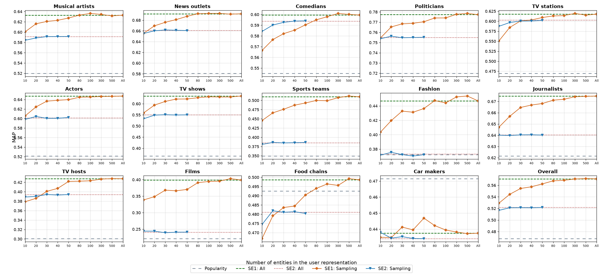
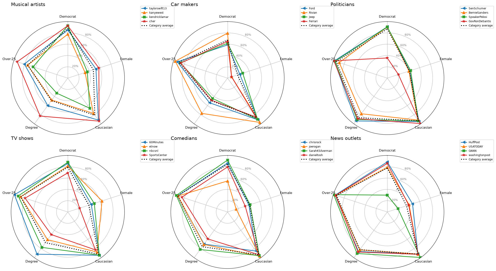

# Reproduction report: *Social Knowledge for Cross-Domain User Preference Modeling*

Generated by `run_reproduction.py`. 'Paper' columns are from arXiv:2603.10148v1; everything else was recomputed from `data/` with the SocialVec embeddings.

## Dataset

- Candidate entities: 276 across 14 categories (the paper says 280 = 14 × 20; four candidates are marked unused in the spreadsheet).
- Users after keeping those who follow more than 10 candidate entities: 11,153 (of 13,800 sampled; the paper says 'roughly 12K').
- Accounts followed per user: 1,972 on average (paper: 1,972), of which 855 are SocialVec entities.
- Closed-world profile size: 34.5 entities on average (40.3 including the target category; the paper says 40).

## Table 2: entity ranking (MAP)

| Category | Entities/user (paper) | Entities/user | Popularity (paper) | Popularity | All (paper) | All | Δ | Sampled (paper) | Sampled | Δ  | All, target removed | Δ   |
|---|---|---|---|---|---|---|---|---|---|---|---|---|
| Musical artists | 7.6 | 7.6 | 0.520 | 0.520 | 0.633 | 0.633 | +22% | 0.591 | 0.591 | +14% | 0.629 | +21% |
| News outlets | 8.2 | 8.2 | 0.581 | 0.581 | 0.692 | 0.692 | +19% | 0.661 | 0.661 | +14% | 0.689 | +19% |
| Comedians | 6.8 | 6.8 | 0.545 | 0.545 | 0.599 | 0.599 | +10% | 0.594 | 0.594 | +9% | 0.596 | +9% |
| Politicians | 11.2 | 11.2 | 0.720 | 0.720 | 0.777 | 0.777 | +8% | 0.755 | 0.755 | +5% | 0.774 | +7% |
| TV stations | 4.5 | 4.5 | 0.469 | 0.469 | 0.618 | 0.618 | +32% | 0.603 | 0.603 | +28% | 0.613 | +31% |
| Actors | 6.6 | 6.6 | 0.521 | 0.521 | 0.647 | 0.647 | +24% | 0.602 | 0.602 | +15% | 0.644 | +24% |
| TV shows | 3.9 | 3.9 | 0.365 | 0.365 | 0.635 | 0.635 | +74% | 0.551 | 0.551 | +51% | 0.631 | +73% |
| Sports teams | 4.3 | 4.3 | 0.349 | 0.349 | 0.510 | 0.510 | +46% | 0.385 | 0.385 | +10% | 0.503 | +44% |
| Fashion | 2.6 | 2.6 | 0.372 | 0.372 | 0.447 | 0.447 | +20% | 0.373 | 0.373 | +0% | 0.442 | +19% |
| Journalists | 10.1 | 10.1 | 0.622 | 0.622 | 0.675 | 0.675 | +9% | 0.640 | 0.640 | +3% | 0.672 | +8% |
| TV hosts | 1.8 | 1.8 | 0.301 | 0.301 | 0.428 | 0.428 | +42% | 0.394 | 0.394 | +31% | 0.423 | +41% |
| Films | 1.4 | 1.4 | 0.221 | 0.221 | 0.399 | 0.399 | +80% | 0.241 | 0.241 | +9% | 0.393 | +78% |
| Food chains | 5.2 | 5.2 | 0.492 | 0.492 | 0.499 | 0.499 | +1% | 0.481 | 0.481 | -2% | 0.494 | +0% |
| Car makers | 5.7 | 5.7 | 0.472 | 0.472 | 0.437 | 0.437 | -7% | 0.434 | 0.434 | -8% | 0.432 | -8% |
| **Overall** |  |  | 0.468 | 0.468 | 0.571 | 0.571 | +22% | 0.522 | 0.522 | +12% | 0.567 | +21% |

Largest absolute difference from the paper over the 42 per-category MAP cells: **0.0005** (the paper rounds to 3 decimals).

*All, target removed*: the 'All' representation with the target category's candidates actually excluded from the user profile, as the paper describes (see the note on the legacy code below).

## Figure 1: MAP vs. number of sampled entities

| Setting | Paper | Reproduced | Target removed |
|---|---|---|---|
| SE1, k = 10 | 0.532 | 0.529 | 0.526 |
| SE1, k = 20 | 0.548 | 0.544 | 0.541 |
| SE1, k = 50 | 0.562 | 0.562 | 0.557 |
| SE1, All | 0.571 | 0.571 | 0.567 |
| SE2, k = 10 | 0.517 | 0.517 |  |
| SE2, k = 20 | 0.521 | 0.521 |  |
| SE2, All | 0.522 | 0.522 |  |

Overall MAP for every sample size:

| k | SE1 (paper setup) | SE1 (target removed) | SE2 |
|---|---|---|---|
| 10 | 0.529 | 0.526 | 0.517 |
| 20 | 0.544 | 0.541 | 0.521 |
| 30 | 0.555 | 0.550 | 0.521 |
| 40 | 0.557 | 0.554 | 0.521 |
| 50 | 0.562 | 0.557 | 0.522 |
| 80 | 0.568 | 0.561 |  |
| 100 | 0.569 | 0.562 |  |
| 300 | 0.571 | 0.566 |  |
| 500 | 0.572 | 0.567 |  |
| 5000 | 0.571 | 0.567 |  |

Ratios quoted in the paper: k = 10 → 92.6% (paper 93.1%), k = 20 → 95.3% (paper 96.0%), k = 50 → 98.5% (paper 98.4%) of SE1-All; SE2 k = 10 → 99.0% (paper 99.0%) of SE2-All.

## Table 3: LLM (GPT-4o) personalization

| Category | Social k=50 (paper) | Social k=50 | llm_baseline (paper) | llm_k12 (paper) | llm_k25 (paper) | llm_k50 (paper) |
|---|---|---|---|---|---|---|
| Musical artists | 0.625 | 0.627 | 0.508 | 0.582 | 0.611 | 0.667 |
| News outlets | 0.688 | 0.687 | 0.648 | 0.695 | 0.698 | 0.716 |
| Comedians | 0.593 | 0.590 | 0.576 | 0.638 | 0.643 | 0.655 |
| Politicians | 0.774 | 0.770 | 0.785 | 0.797 | 0.801 | 0.811 |
| TV stations | 0.605 | 0.609 | 0.507 | 0.636 | 0.640 | 0.664 |
| Actors | 0.637 | 0.640 | 0.511 | 0.605 | 0.603 | 0.662 |
| TV shows | 0.622 | 0.622 | 0.427 | 0.595 | 0.612 | 0.637 |
| Sports teams | 0.495 | 0.493 | 0.347 | 0.393 | 0.391 | 0.571 |
| Fashion | 0.443 | 0.436 | 0.377 | 0.409 | 0.409 | 0.493 |
| Journalists | 0.668 | 0.668 | 0.680 | 0.673 | 0.675 | 0.704 |
| TV hosts | 0.422 | 0.422 | 0.313 | 0.436 | 0.451 | 0.522 |
| Films | 0.372 | 0.370 | 0.216 | 0.306 | 0.308 | 0.399 |
| Food chains | 0.485 | 0.490 | 0.492 | 0.496 | 0.504 | 0.496 |
| Car makers | 0.438 | 0.447 | 0.472 | 0.480 | 0.487 | 0.409 |
| **Average** | 0.562 | 0.562 | 0.490 | 0.553 | 0.559 | 0.600 |

The GPT-4o columns were **not re-run**: they need Azure OpenAI credentials and about 33.5K model calls. Run `python run_reproduction.py --llm` to produce them (see README). The 'Social k=50' column is the SE1 k = 50 setting of Figure 1.

## Table 4: k categories × n entities (closed world)

**Paper:**

| k \ n | 1 | 2 | 3 | 4 | 5 | 6 | 7 |
|---|---|---|---|---|---|---|---|
| 1 | 0.471 | 0.478 | 0.482 | 0.485 | 0.485 | 0.485 | 0.485 |
| 2 | 0.476 | 0.490 | 0.496 | 0.500 | 0.501 | 0.501 | 0.502 |
| 3 | 0.476 | 0.493 | 0.503 | 0.506 | 0.509 | 0.511 | 0.511 |
| 4 | 0.477 | 0.493 | 0.500 | 0.508 | 0.511 | 0.516 | 0.516 |
| 5 | 0.477 | 0.495 | 0.507 | 0.512 | 0.515 | 0.517 | 0.518 |

**Reproduced, n entities from each of k categories** (the protocol as described): mean absolute difference from the paper 0.0070

| k \ n | 1 | 2 | 3 | 4 | 5 | 6 | 7 |
|---|---|---|---|---|---|---|---|
| 1 | 0.472 | 0.480 | 0.483 | 0.484 | 0.485 | 0.485 | 0.486 |
| 2 | 0.489 | 0.499 | 0.501 | 0.502 | 0.502 | 0.502 | 0.502 |
| 3 | 0.501 | 0.507 | 0.509 | 0.510 | 0.511 | 0.511 | 0.511 |
| 4 | 0.507 | 0.513 | 0.515 | 0.516 | 0.517 | 0.516 | 0.517 |
| 5 | 0.511 | 0.516 | 0.517 | 0.518 | 0.518 | 0.518 | 0.519 |

**Reproduced, n entities in total from the union of k categories**: mean absolute difference 0.0022

| k \ n | 1 | 2 | 3 | 4 | 5 | 6 | 7 |
|---|---|---|---|---|---|---|---|
| 1 | 0.473 | 0.481 | 0.484 | 0.485 | 0.485 | 0.486 | 0.486 |
| 2 | 0.476 | 0.489 | 0.495 | 0.498 | 0.500 | 0.501 | 0.502 |
| 3 | 0.476 | 0.491 | 0.500 | 0.504 | 0.506 | 0.509 | 0.509 |
| 4 | 0.478 | 0.493 | 0.499 | 0.504 | 0.507 | 0.510 | 0.513 |
| 5 | 0.478 | 0.495 | 0.502 | 0.505 | 0.508 | 0.511 | 0.514 |

The code for Table 4 is not in the legacy notebooks. The first row and last column match under both readings. The paper's n = 1 column barely changes with k (0.471 → 0.477), which the pooled reading reproduces and the per-category reading does not. Both readings support the paper's conclusion: 3-5 categories with 4-5 entities each recover nearly all of SE2-All (0.522).

## Figure 2: socio-demographic profiles of followers

### Musical artists

|  | Democrat (notebook) | Democrat (reproduced) | Female (notebook) | Female (reproduced) | Caucasian (notebook) | Caucasian (reproduced) | Degree (notebook) | Degree (reproduced) | Over-25 (notebook) | Over-25 (reproduced) |
|---|---|---|---|---|---|---|---|---|---|---|
| taylorswift13 | 0.840 | 0.852 | 0.507 | 0.523 | 0.919 | 0.917 | 0.616 | 0.600 | 0.815 | 0.805 |
| kanyewest | 0.779 | 0.777 | 0.330 | 0.320 | 0.792 | 0.770 | 0.512 | 0.480 | 0.760 | 0.743 |
| kendricklamar | 0.905 | 0.925 | 0.372 | 0.362 | 0.697 | 0.659 | 0.386 | 0.329 | 0.679 | 0.643 |
| cher | 0.908 | 0.927 | 0.555 | 0.576 | 0.937 | 0.940 | 0.808 | 0.829 | 0.930 | 0.937 |
| ALL | 0.865 | 0.879 | 0.467 | 0.475 | 0.828 | 0.811 | 0.523 | 0.492 | 0.762 | 0.743 |

### Car makers

|  | Democrat (notebook) | Democrat (reproduced) | Female (notebook) | Female (reproduced) | Caucasian (notebook) | Caucasian (reproduced) | Degree (notebook) | Degree (reproduced) | Over-25 (notebook) | Over-25 (reproduced) |
|---|---|---|---|---|---|---|---|---|---|---|
| Ford | 0.633 | 0.587 | 0.271 | 0.227 | 0.923 | 0.912 | 0.587 | 0.539 | 0.920 | 0.931 |
| Rivian | 0.803 | 0.796 | 0.115 | 0.076 | 0.955 | 0.968 | 0.752 | 0.771 | 0.949 | 0.968 |
| Jeep | 0.658 | 0.616 | 0.315 | 0.281 | 0.908 | 0.903 | 0.483 | 0.446 | 0.860 | 0.873 |
| Ferrari | 0.673 | 0.650 | 0.126 | 0.075 | 0.857 | 0.850 | 0.497 | 0.483 | 0.844 | 0.864 |
| ALL | 0.697 | 0.673 | 0.222 | 0.186 | 0.876 | 0.865 | 0.532 | 0.492 | 0.892 | 0.901 |

### Politicians

|  | Democrat (notebook) | Democrat (reproduced) | Female (notebook) | Female (reproduced) | Caucasian (notebook) | Caucasian (reproduced) | Degree (notebook) | Degree (reproduced) | Over-25 (notebook) | Over-25 (reproduced) |
|---|---|---|---|---|---|---|---|---|---|---|
| SenSchumer | 0.893 | 0.908 | 0.411 | 0.415 | 0.948 | 0.951 | 0.915 | 0.937 | 0.972 | 0.982 |
| BernieSanders | 0.890 | 0.905 | 0.402 | 0.402 | 0.918 | 0.916 | 0.776 | 0.779 | 0.890 | 0.890 |
| SpeakerPelosi | 0.890 | 0.905 | 0.429 | 0.433 | 0.931 | 0.933 | 0.884 | 0.904 | 0.955 | 0.967 |
| GovRonDeSantis | 0.406 | 0.357 | 0.230 | 0.207 | 0.984 | 0.993 | 0.872 | 0.887 | 0.974 | 0.990 |
| ALL | 0.871 | 0.872 | 0.413 | 0.412 | 0.931 | 0.932 | 0.856 | 0.865 | 0.938 | 0.944 |

### TV shows

|  | Democrat (notebook) | Democrat (reproduced) | Female (notebook) | Female (reproduced) | Caucasian (notebook) | Caucasian (reproduced) | Degree (notebook) | Degree (reproduced) | Over-25 (notebook) | Over-25 (reproduced) |
|---|---|---|---|---|---|---|---|---|---|---|
| 60Minutes | 0.849 | 0.857 | 0.433 | 0.435 | 0.948 | 0.947 | 0.897 | 0.923 | 0.973 | 0.989 |
| etnow | 0.802 | 0.812 | 0.590 | 0.634 | 0.888 | 0.876 | 0.617 | 0.605 | 0.876 | 0.872 |
| nbcsnl | 0.869 | 0.880 | 0.482 | 0.492 | 0.946 | 0.944 | 0.773 | 0.774 | 0.916 | 0.918 |
| SportsCenter | 0.704 | 0.692 | 0.250 | 0.219 | 0.842 | 0.828 | 0.520 | 0.494 | 0.797 | 0.791 |
| ALL | 0.792 | 0.793 | 0.390 | 0.389 | 0.926 | 0.925 | 0.681 | 0.670 | 0.873 | 0.872 |

### Comedians

|  | Democrat (notebook) | Democrat (reproduced) | Female (notebook) | Female (reproduced) | Caucasian (notebook) | Caucasian (reproduced) | Degree (notebook) | Degree (reproduced) | Over-25 (notebook) | Over-25 (reproduced) |
|---|---|---|---|---|---|---|---|---|---|---|
| chrisrock | 0.858 | 0.866 | 0.391 | 0.397 | 0.864 | 0.854 | 0.704 | 0.703 | 0.917 | 0.922 |
| joerogan | 0.576 | 0.549 | 0.193 | 0.161 | 0.958 | 0.967 | 0.708 | 0.710 | 0.906 | 0.917 |
| SarahKSilverman | 0.899 | 0.918 | 0.415 | 0.419 | 0.949 | 0.954 | 0.811 | 0.820 | 0.944 | 0.949 |
| danieltosh | 0.795 | 0.797 | 0.344 | 0.329 | 0.931 | 0.931 | 0.609 | 0.589 | 0.847 | 0.846 |
| ALL | 0.838 | 0.845 | 0.409 | 0.411 | 0.933 | 0.934 | 0.757 | 0.759 | 0.919 | 0.925 |

### News outlets

|  | Democrat (notebook) | Democrat (reproduced) | Female (notebook) | Female (reproduced) | Caucasian (notebook) | Caucasian (reproduced) | Degree (notebook) | Degree (reproduced) | Over-25 (notebook) | Over-25 (reproduced) |
|---|---|---|---|---|---|---|---|---|---|---|
| HuffPost | 0.869 | 0.886 | 0.461 | 0.468 | 0.920 | 0.919 | 0.851 | 0.864 | 0.955 | 0.965 |
| USATODAY | 0.785 | 0.791 | 0.403 | 0.406 | 0.923 | 0.920 | 0.819 | 0.826 | 0.945 | 0.957 |
| OANN | 0.351 | 0.299 | 0.223 | 0.198 | 0.985 | 0.994 | 0.896 | 0.907 | 0.978 | 0.993 |
| washingtonpost | 0.852 | 0.859 | 0.397 | 0.397 | 0.924 | 0.925 | 0.857 | 0.875 | 0.945 | 0.956 |
| ALL | 0.777 | 0.779 | 0.363 | 0.357 | 0.923 | 0.922 | 0.815 | 0.823 | 0.930 | 0.939 |

Mean absolute difference from the values in the notebook (which produced the paper's figure): **0.014** (max 0.057).

## Notes on the legacy code and differences

1. **Target entities were not removed in the 'All' setting.** The notebook builds the 'All' user profile
   as `set(friend ids as strings) - set(user['topic_accounts_str'])`. But `topic_accounts_str` holds
   *screen names*, so the subtraction removes nothing, and the target category's candidates stay in the
   profile. The same applies to SE1 sampling and to the LLM k = 50 prompts. This reproduction reports
   both versions. Removing the target entities properly changes overall MAP from 0.571 to 0.567
   (+22% → +21% over popularity), so the paper's conclusions hold. The closed-world ('Sampled' / SE2)
   setting was implemented correctly.
2. **SE1 sampling order.** The legacy code sampled from a Python `set` of id *strings*, whose order
   depends on per-process hash randomization, so its SE1 samples cannot be redrawn exactly. We sample
   with the same seed (76) from the follow list in its stored order; overall values land within
   ±0.004 of the paper. SE2 samples come from a set of *integers*, which has a deterministic order, and
   match the notebook's output exactly.
3. **SE1 samples accounts, not entities.** Like the legacy code, SE1 draws k *followed accounts*. Only
   ~43% of them are SocialVec entities, so a k = 10 sample holds ~4 entities on average.
4. **Socio-demographic classifiers.** The `socialvec` package labels the age and education classifier
   outputs the opposite way round from the paper's Figure 2. We follow the figure. With the package's
   labels, ~98% of *60 Minutes* followers would be under 25.
5. **Table 4** — see the section above; the code behind it is not in the notebooks.
6. **Table 3 (GPT-4o)** needs API access and is not part of the default run.
